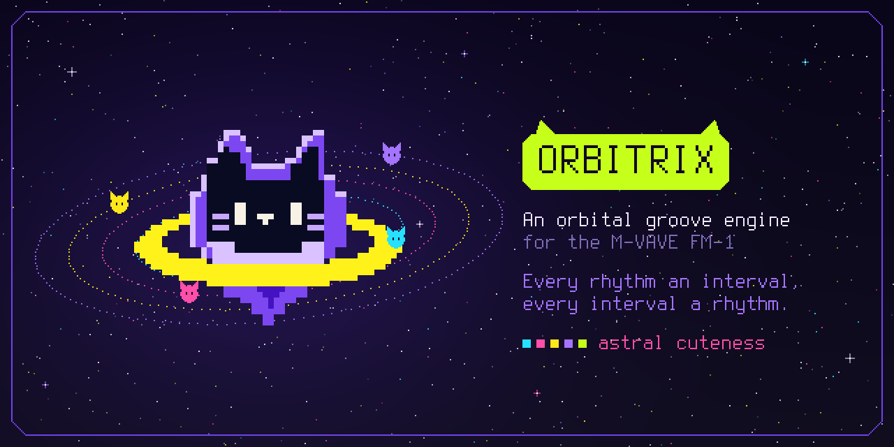
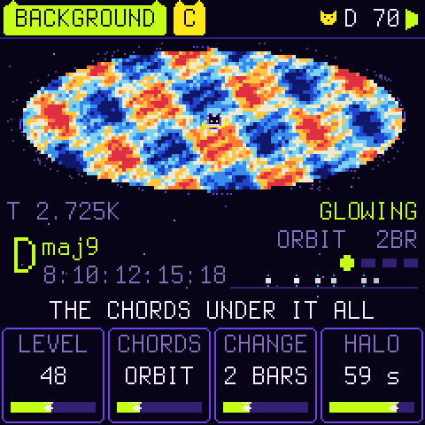
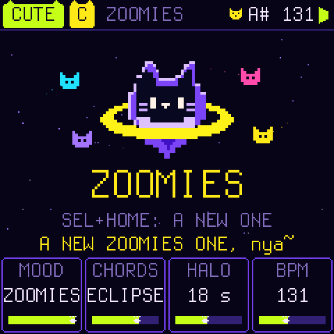
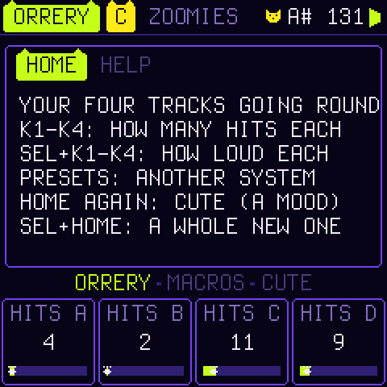

<p align="center">
  
</p>

<p align="center">
  
  
  
  
</p>

<p align="center">
  <a href="https://joakimskurk.github.io/fm1orbitrix/"><b>The page: play it in the browser, and install it from there →</b></a>
</p>

<p align="center">
  
  
  
</p>

Four planets circle a sun. How fast each one goes against the others is a small ratio, 1:1, 5:4, 3:2, 7:4, and the
same ratio heard as pitch is a pure interval above the sun. So a polyrhythm of 4 against 5 against 6 against 7 *is*
the chord 4:5:6:7. The rhythms are strange: quintuplets against septuplets, and cycles that meet only every few bars.
But every note sits on the sun's harmonic series, so the whole thing fuses into one chord without a beat.

The voice is a planet on an ellipse, and what you hear is where it is.

> **Status:** in development. Everything here runs on the host (the same C, the sound as WAV, the screen as images)
> and in the browser on [the page](https://joakimskurk.github.io/fm1orbitrix/) (the same C, compiled to WebAssembly).
> It builds for the FM-1 and the SMK-37 and passes Dinghy's checks and tests. It has **not yet been tested on a real
> FM-1**, and there is no release yet.

## A groove in a minute

1. Switch on. After the splash (**PLAY** skips it) **KITTEN** is waiting: a boop on the beat, a clap and hats
   whispering, a purring bass, on the grid. Press **PLAY**.
2. Press **SEQ**: **STEPS**. The white keys are the steps of a track: tap one, rest → hit → accent → rest. The black
   keys do the rest, and the screen draws each one over its key:

   | Black keys | |
   | --- | --- |
   | **F# G# A# C#** (lower) | pick track A, B, C, D |
   | **D#** (lower) | **IDEA**: a new pattern for the track, as its sound wants one (a kick on the beat, a snare's backbeat, hats between, a bass on the root, a melody on the chord's tones) |
   | **F# G# A# C#** (upper) | mute A, B, C, D (lit while it plays; muted, it naps) |
   | **D#** (upper) · **F#** (top) | **CLEAR** the track · **UNDO** (and again: redo) |

3. Press **EDIT**: **SOUND**. K1 picks the track's sound by name from 30 (BOOM, THUMP, TOM, PAT, CLAP, TICK, TSSS,
   ZAP, BOOP, SQUEAK, BLOOP, PURR, GROWL, SUB, SWOOP, PLUCK, PAW, GLASS, BELL, STAR, TIDAL, TOY, PIXEL, LEAD, FLUTE,
   MEOW, MEW, CLOUD, DRONE, COMET);
   stopped, you hear it at once. K2–K4: TONE, DECAY, LEVEL; with SEL: OCT, PAN, SPACE, WOBBLE.
4. The keys play the **focus**, the chip at the top: a track's sound (where its ring plays it) or, as K, the keys' own.
   **REC** writes what you play into the track (from K, into the track with a tune, which it names): the key plays
   the note written, so what you hear is what you get, on the step nearest your key; on every page while it is on.
   Stopped, REC waits: the first key starts it all (or PLAY, after a bar's count-in). Played something good without
   REC? **Hold REC**: it is caught. **SEL + OCT−** undoes a take. **SELECT** turns the focus.
5. **HOME**: K1–K4 set each track's hits; with SEL, their levels. **SAVE**, **SAVE** keeps it in U1.

Not sure what a button does? **Hold it a second.** It comes SIMPLE, the friendly pages only; **SEL + SAVE** wakes the
deep ones (EDIT is then SOUND → ORBIT → BODY → COSMOS, from the friendly to the deep). For a lullaby, turn
**PRESETS** once: **MILKY WAY**. KITTEN, MILKY WAY and ALPHA CEN play their keys **IN KEY**: the white keys the scale,
C the sun, none wrong.

## Astralica, at home

She is the sun the orbits go round. She bobs on every beat, blinks, and a note rises from her each bar; her eyes light
where the orbits meet, and close happily (^ ^) at an IDEA, a SAVE, a new system or PLAY. Play the keys and she sings
along in a bubble (mew, nya, mrrp, prr). Stop, and she naps: zz. The planets are her kittens, in their tracks' colours;
an accent is a heart, a hit on STEPS a paw, and hearts rise when you set one. Every title and focus wears ears, every
gauge ends in a paw; TIME's playhead and the LFOs carry a kitten, the ORBIT PAD's point is one, COSMOS is five of them
round her, CHAOS is a ball of yarn, TIDE a fish, HORIZON a black hole with ears, and on KEYS the keys you play show a paw.

## The legend of Astralica

In the beginning the universe was silent. Then came **Astralica**, a black cat in a violet coat with a yellow ring
round her. She grew, and grew: one big ass cat. She ate all the planets, and in her tummy they changed; and when she
pooped them out, they formed the ORBITRIX. Now her song rings through the multiverses.

It is told on [the page](https://joakimskurk.github.io/fm1orbitrix/#legend), as an animation on a transparent night,
seventeen seconds, drawn and scored by the firmware itself (its own screen and engine, filmed on the host by
`tools/make_legend.py`): a drone, a chirp as each of the four planets falls in, the universe sliding into her
horizon; her tummy glowing and gurgling as they turn in it; then plop, plop, plop, plop: four little cosmic swirls,
each becoming a kitten that flies out to its ring, and each ring starts to sing as its kitten arrives. Last her meow,
echoing from universe to universe. The kittens are the planets that go round her on HOME. The FM-1 itself starts
with the splash and goes straight to the instrument; the legend's sound is in it as four systems to play (ASTRALICA,
NOM NOM, TUMMY, MULTIVERSE: its drone, chirps, gurgles, plops, glass rings and meow, in its echoes and nebula).

<p align="center">
  
</p>

## The sound: orbit synthesis

| | |
| --- | --- |
| **ECC** | The orbit's eccentricity, solved from Kepler's equation `M = E − e sin E` by table. At 0 it is a pure sine. Turned up, the planet slows far out and whips through the near point, and the sound brightens. Its spectrum is a series of Bessel functions, as in FM: Bessel found them solving this very equation. |
| **SLING** | Hear the planet's speed instead of its place: the slingshot past the sun, a bright pulse. |
| **ANG**, **SPR** | Which view of the orbit you hear: x and y have different spectra. The left channel looks from one angle and the right from another, so the stereo comes from the geometry. L + R is again a view, so it never cancels in mono. |
| **PREC** | Precession: the ellipse turns slowly, and the timbre and the stereo image turn with it. |
| **MOON**, its **RATIO** | A moon circling the planet, an epicycle. On whole ratios it adds harmonics; on φ, √2, e, π or a bell's 2.76 it adds metal and glass. |
| **DUST**, **COLOR** | Noise in the orbit, dark to bright: breath, hiss, a snare's wires, comets. |
| **PIXEL** | The orbit on a coarse grid: an 8-bit planet. |
| **FALL** | The pitch falls onto the note: a kick's infall, a tom, a swoop. |

Each sound also has an amplitude envelope, an eccentricity envelope (the orbit stretching and relaxing, as FM's index
envelope), velocity, pan and a send to SPACE. A per-note cap, measured from the spectra, keeps the aliases above
20 kHz (60 dB down), and the tests check it.

## The strange part: tide, inspiral, beam, horizon

Most of the time ORBITRIX is in tune with itself. These four push it somewhere stranger, and most systems use them
only at moments: where the orbits meet, at the end of a long ramp, when the pad's point dips.

| | |
| --- | --- |
| **TIDE** | The planets pull on each other: the voices' sum, a block late, modulates each one's phase (FM between the voices). The rings stand on ratios of one sun, so the sidebands land on that sun's harmonic series: alien, metallic, and still consonant. Turned far up it becomes the three-body problem. Each sound sets how hard it is pulled; the TIDE macro and the TIDE destination set how strong the pull is (CONJ → TIDE: they tug where they meet). |
| **INSPIRAL** | A binary's chirp: the note starts up to four octaves under and rises along a merger's law (frequency as (t_c − t)^−3/8, slow, then all at once), growing as it rises, and lands exactly on the note. At the merge the eccentricity envelope flashes: the ring-down. |
| **BEAM** | A pulsar: the planet's light sweeps past in narrow pulses at the moon's ratio (amplitude modulation at audio rate). |
| **HORIZON** | The sound falls into a black hole. A memory of the mix and two grains about a source point that slows to a standstill. It is redshifted (SHIFT, down to two octaves at full depth; blueshift too), stretched, frozen when deep, and RETRO plays a share of the grains backwards. It is a macro and a destination: LFO 1's ramp, or the pad's point dipping, take the music in now and then. |

<p align="center">
  
  
  
</p>

## Under it all: the background radiation, the nebula, tired light

The universe's oldest light, the afterglow of the Big Bang, comes from every side at the same 2.725 K, but for tiny
fluctuations. ORBITRIX lays it under the music as chords: a carpet that lies behind the rings when it fits, and goes
when it does not:

| | |
| --- | --- |
| **BACKGROUND RADIATION** | GLO's page: chords under it all. **CHORDS** picks a progression: SUN (the sun's own chord, held), TIDES (two, swaying), ORBIT, DUSK, COMET, ECLIPSE (darker, borrowed), LULLABY (over the sun in the bass), VOYAGE (eight chords). Each is written for each tuning in that tuning's own notes, so it never clashes with the rings: in JUST pure chords (add9, m7, maj7, 6, no D with A: the scale's wolf), in OTONAL pieces of the sun's harmonic series (4:5:6:7:9, 10:12:15:18, 6:7:9 …), in UTONAL of its subharmonics (the minor the sun crowns), in PENTA the five notes only. They are voiced and led once, ahead of time (tools/gen_tables.py): a bass above the rings' bass, up to seven voices over it, open (no thirds low down, no minor ninths), each chord into the next by the least movement, the notes two chords share held. **CHANGE**: a chord every 1, 2, 4 or 8 bars, on the bar. A note never glides: a voice whose note changes fades out, takes its new note in silence and swells in, the lowest first, so the chord blooms upwards. Each voice is two soft oscillators a few cents apart, one each side (**WIDTH**). **HALO** is its own space, a reverb only for it and all wet: no dry chord at all, only its light, 3 s to two minutes long (four lines at a quarter of the rate, damped and slowly swimming, so the tail never stands still and never rings), the chords floating into each other; at 0 it is dry. **SILK** softens it, **TEMP** is its octave (0.7 K … 5.5 K: Wien's law, twice the temperature, twice the frequency), **LOW CUT** thins its low end (and what goes into the nebula), **GLOW** feeds it into NEBULA as well. It swells in on PLAY and fades on STOP; **SEL + GLO** takes it out and brings it back. The page shows the chord, its ratios, the progression and each voice as a star. |
| **BLOOM** | HORIZON's second row, beside TIRED. NEBULA's own light back into it: its lines' feedback up towards 0.985 and a little of its wet again through the diffusers. The tail gets far longer and denser at no cost (no new lines); the two never sum past 0.999, so it is stable. The lines now run hotter, rounded once, and saturate softly, so the tail's last 20 dB are heard instead of cut. When the sun moves, the nebula clears a moment, so the old chord's tail does not clash with the new. |
| **TIRED LIGHT** | HORIZON's second row. Zwicky's 1929 idea, long given up, that light tires on its way and reddens with distance; here it is an echo: what goes round again is read slower than it was written, so each echo comes back a just interval lower than the last (z 0.07 a semitone … z 0.50 a fifth … z 1.00 an octave) and, through the echo's tone, dimmer: redder. |

<p align="center">
  
</p>

## Harmony: gravity

Everything is tuned to the **sun**, a pitch class you move with SEL + a key.

- **Tunings:** JUST (5- and 7-limit), OTONAL (the overtone scale: 1/1 9/8 5/4 11/8 3/2 13/8 7/4 15/8), UTONAL (its
  dark mirror), PENTA, and ET.
- **SOLAR keys:** the ordinary keyboard, each key retuned to its interval's ratio above the sun. Chords ring without
  beating. The KEYS page shows each key's cents.
- **HARMONIC keys:** the 16 white keys are harmonics 1–16 of the sun, the black keys 17–27. Play the overtone series
  itself.
- **GRAVITY:** at 0, equal temperament as played; at 50, fully just. Above 50 a note *falls* into tune: it starts
  where the last one was and spirals in on a damped spring, overshooting and settling, like a voice finding the pitch.

<p align="center">
  
  
  
</p>

## Rhythm: the Orrery

There are four rings, A–D, each with its own sound and one voice, so a conjunction is a chord across the rings. Four
more voices are for the keys.

| | |
| --- | --- |
| **SPEED** | The ring's speed against a 16th: 1:4 … 1:1 … 5:4, 3:2, 7:4 … 4:1. The clock counts 2520 ticks a 16th (lcm 1..10), so every ratio meets the others exactly, forever. |
| **LEN**, **HITS**, **ROT** | Up to 64 steps, hits spread evenly and turned. Set steps by hand on the white keys (STEPS). |
| **NOTE** | The degree the ring sings; each step adds its own (hold a step, turn K1). The screen names it as a ratio. |
| **DIR** | FWD, REV, PING, SPIRAL (the pattern turns one step each lap: rhythmic precession), RND. |
| **LOGIC** | FREE, AND x, NOT x, XOR x against another ring's current step, or CONJ: only together with another ring. NOT makes interlocking parts. |
| **Conjunctions** | When rings fire on the same tick, those hits are accented and the CONJ modulation source flares. The long cycle's downbeats show up by themselves. |

SWING, **MUTATE** (each lap plays a variation of the pattern: some hits move a step, some degrees go to a neighbour;
drawn afresh each lap from the pattern as you wrote it, which never changes: the orrery shows the varied steps hollow),
**HUM** (humanised timing and velocity) and **VAR** apply to all four rings.

<p align="center">
  
  
  
</p>

## Movement and FX

- **Macros:** CHAOS (the orbits wobble and the moons drift off whole ratios), SPECTRAL (brighter), GRAVITY, ORBIT
  (wider, turning faster), and on the second row FRACT (pixels, and hits splitting into 2–4 ratchets), TIDE, HORIZON
  and MUTATE. At 0 each one leaves the system as programmed.
- **ORBIT PAD:** a point circling (X, Y) at a radius, once in its period (1/8 to 16 bars, on the orrery's clock). Its
  X and Y are modulation sources.
- **Modulation:** two LFOs (sine, triangle, saw, square, S&H, drift; free or on the clock) and an 8-slot matrix from
  LFO1 LFO2 ORB-X ORB-Y RND STEP CONJ VEL MODW AFT onto ECC SLING ANG SPR MOON DUST PIXEL PITCH CUT RES MODE SEND FDBK
  RAD PREC LEVEL PROB TIDE HORIZON BEAM.
- **FILTER MAP:** a stereo state-variable filter on the master, its mode morphing LP → BP → HP, with drive. While it
  is open it costs nothing.
- **SPACE:** a stereo delay in beat fractions (ping-pong, tone) into **NEBULA**, a four-line feedback delay network
  with size, damping and a **DECAY** in seconds, 0.6 s to two minutes (as long whatever the size; damping is the
  tail's colour, so a long one is long in the middle too). Each sound has its own send.

<p align="center">
  
  
  
</p>

## Twenty systems

Each is its own kind of music, with its own tempo, sounds and space, and each sounds right the moment it plays. In
every one with chords the bass and the melodies FOLLOW them: they play the chord's own notes, so they change with it on
the bar, and whatever CHORDS is turned to, nothing clashes. None has a kick: where the beat is, a pitched pulse plays it
(a boop, glass, a bell), the snares and hats whisper (-12 dB, dry), and the spaces are long, from 15 s for the grooves
to two minutes for MULTIVERSE.

| | | |
| --- | --- | --- |
| **KITTEN** | a beat to start from, 104 | a boop on the beat (root, fifth, third, fifth), a clap's backbeat and hats in 8ths whispering, a purring bass on the root, its fifth and 7/4; the keys a soft paw. Nothing mutates: yours to change |
| **MILKY WAY** | a lullaby, 86 | a music box twinkling at 3:2 over pitched boops, glass on 1 and 3, a purring bass at half speed, pentatonic, a little swing, the chords under it; the keys mew |
| **HARMONICES** | the idea, 96 | 4, 5, 6 and 7 hits a bar at 1:1 5:4 3:2 7:4: the chord 4:5:6:7 as a rhythm and as a chord, in the overtone scale |
| **PURRSEC** | lo-fi, 84, swung | a cat café: a paw on the chord's upper notes, a brushed pat, ticking hats that come and go, the purr on the royal road (Gmaj7 A6 F#m7 Bm9), dark short chords; a toy piano |
| **ZOOMIES** | house, 124 | a kitten's mad minute: a boop bouncing four on the floor, a clap, a squeak chasing at 3:2, a growl bouncing on the bass and fifth, a chord a bar; a pixel lead |
| **CATWALK** | disco, 116 | glass four on the floor, a clap, plucked chord stabs off the beat, the purr in sixteenths, a chord a bar, glossy; a lead |
| **SPIRAL** | generative, 112 | 16 24 20 28 steps at 1:1 3:2 5:4 7:5, all SPIRAL, PROB 74, MUTATE 30: never twice the same, every note in the chord (VOYAGE: eight of them) |
| **LUNA NOVA** | bossa nova, 92 | a rim on the clave, a shaker, a paw comping jazz chords (Am9 Fmaj7 Cadd9 Em7), the bass on the root and fifth; a flute |
| **SGR A\*** | dub, 72 | one drop: a deep bell and the rim on three, a pluck skanking into long echoes that tire a minor third each time (steps, never a slide), a sub walking the chords |
| **BOOP BOP** | chiptune, 140 | dry: a pixel arpeggio up and down the chord in sixteenths, a pixel bass, a bloop and a zap; the chords silent, only played |
| **SNOWGLOBE** | a music box, 96, in 12/8 | the rings at 3:4, twelve steps a bar: a bell turning, a toy answering, stars falling, a sub on the bass and fifth, no drums |
| **STARDUST** | synth pop, 108 | on the overtone series (maj9 m7 6 add9): a bell on one and three, glass arpeggiating, stars at 3:2, a sub, a halo |
| **ALPHA CEN** | a gamelan, 100 | a triple star: two bells interlocking (one on the beat, one between), a slow melody, a gong; TIDE makes them shimmer and beat as a gamelan's pairs do; pentatonic, no chords |
| **MOON NAP** | a lullaby, 66 | on the subharmonics (Dm Bbmaj7 Gm7): a paw rocking the chord, a music box at 5:4, now and then a star, a slow sub, a long halo, no drums; her mew |
| **AFTERGLOW** | ambient, 70 | the oldest light: chords on the overtone series in a long halo, a sub, glass at 5:4, stars at 7:4, boops at 3:2, the nebula blooming, echoes that tire |
| **PULSAR** | minimal techno, 128 | boops four on the floor, open hats off the beat, zaps pulsing on the chord (BEAM), a rolling sub, a resonant filter breathing slowly |
| **ASTRALICA** | the legend's universe, 100 | the film itself: the dark drone held on the sun, the orrery's glass rings at 5:4 3:2 7:4 on 4:5:6:7, the legend's long echoes and vast nebula; the keys her meow |
| **NOM NOM** | the legend's universe, 88 | the planets eaten, half time: a gulp on one and three, chirps falling in from octaves under on the eighths, plops at 3:2 on the rings' notes, the drone under; her meow |
| **TUMMY** | the legend's universe, 76 | her tummy glowing and gurgling: bubbles in a syncopated sixteenth, boops at 5:4, glints of glass at 7:4, the drone low, everything wobbling (TIDE); she mews |
| **MULTIVERSE** | the legend's universe, 60 | her meow from universe to universe, no beat: the drone held four bars at a time, a meow whose echoes come back a fourth lower each time (TIRED LIGHT), bells at 7:4, a star |

There are also eight places of your own, U1–U8.

## Making cute things

- **CUTE** (HOME's third page): Astralica in the mood, and **SEL + HOME** makes a whole new patch in it: SLEEPY,
  PLAYFUL, SPARKLY or ZOOMIES. Each mood has its sounds for each role, its tunings and chords, its tempos and space,
  and rhythms written by hand to pick from; every pitched ring follows the chords and the keys are CHORD keys, so
  whatever comes out is in tune with itself. Another press, another one; SAVE keeps it.
- **MOOD** (CUTE's K1) turns the patch playing to a mood: its tempo, sounds, space and chords, its patterns kept (their
  notes moved to the nearest note of the chord, so they stay where they were).
- **FOLLOW** (STEPS, ALGORITHM): a ring plays the chord's own notes instead of the tuning's degrees: #0 the chord's
  bass, #1 the next note up, #2 the next, and so on round, an octave a round. A bass on #0 walks the chords' roots, a
  melody on #2 to #5 moves with each chord, whatever the progression; MUTATE then only steps it along the chord.
- **IDEA knows the chords**: on a bass, a melody, boops or a voice it writes a FOLLOW pattern (a bass on the chord's
  bass and its neighbours, a melody walking its notes).
- **CHORD keys** (KEYS' MODE): every white key a note of the chord sounding now (C4 its bass, going up), a black key the
  one under it an octave up; the KEYS page names what each key plays, its bass lit. Nothing on the keyboard is wrong.
- **IN KEY keys** (KEYS' MODE): the white keys the scale, C the sun, going up as on any keyboard (each the tuning's
  own note nearest the major scale's), a black key the one under it an octave up. Nothing wrong here either, and the
  melody you play stays put when the chords change.
- **What you play is what it keeps**: REC writes the note you hear, kept as played even on a track that follows the
  chords; hold REC to catch what you just played; anything that changes the music while it plays (a system, CUTE, an
  IDEA, a MOOD) waits for the next bar.

<p align="center">
  
</p>

## The controls

Every page is laid out the same way. The top line holds the page, the focus (K for the keys, or A–D), the system
(or REC, lit while it records, blinking while it waits), the sun with Astralica's head, and the tempo. Then come the
picture, the hint line (a message, a button's pages, what the page is for in plain words, what waits for the bar, or
ALGORITHM's value and the load) and K1–K4 as four boxes.

- **Hold any button a second** and a card says what it does (hold SEL alone a little longer: every SEL combination).
- **SIMPLE** (as it comes): each button opens its friendly page only, HOME the orrery and CUTE, SEQ STEPS, EDIT SOUND,
  FX SPACE, GLO BACKGROUND, ARP KEYS; ENV and LFO are asleep. **SEL + SAVE** wakes every page (DEEP), and again puts
  them to sleep.
- **On the bar:** while it plays, a new system (PRESETS), a CUTE one, an IDEA and a MOOD wait for the next bar, just
  before it (the hint line says what is coming), so the music never stumbles; a new system or a CUTE one starts the
  orrery from the top.
- **UNDO everywhere: SEL + OCT−** undoes the last gesture (a take or a catch: all it wrote, on every track it wrote on);
  again, it is redone.

<p align="center">
  
</p>

| Control | What it does |
| --- | --- |
| **HOME** | ORRERY (K1–K4: the hits of A–D; SEL: their levels) → MACROS (DEEP) (CHAOS SPECTRAL GRAVITY ORBIT · FRACT TIDE HORIZON MUTATE) → CUTE (MOOD CHORDS HALO BPM · CHORD LV CHANGE SWING KEYS) |
| **SEQ** | STEPS (SPEED LEN HITS ROT · NOTE DIR PROB LOGIC · ALGORITHM: FOLLOW; the keys as above) → TIME (DEEP) (tempo, swing, mutate, the lanes · ALGORITHM: HOLD, a note held till the ring's next hit: a drone) |
| **EDIT** | SOUND (SOUND TONE DECAY LEVEL · OCT PAN SPACE WOBBLE) → (DEEP:) ORBIT (ECC SLING ANG SPR · PREC MOON RATIO DUST) → BODY (FALL COLOR PIXEL · LEVEL PAN SEND OCT) → COSMOS (TIDE INSPIRAL INSP-T BEAM) |
| **ENV** · **LFO** | (DEEP) the envelopes · MOD → LFO |
| **FX** · **GLO** · **ARP** | FILTER MAP → SPACE → HORIZON (DEPTH SHIFT RETRO GRAIN · TIRED BLOOM; SIMPLE: SPACE only) · BACKGROUND (LEVEL CHORDS CHANGE HALO · SILK WIDTH LOW CUT TEMP · ALGORITHM: GLOW) → ORBIT PAD (DEEP) · KEYS (mode: CHORD, every key a note of the chord now; IN KEY, the white keys the scale with C the sun, a black key the white one under it an octave up; SOLAR; HARMONIC; tuning, sun, octave, gravity, MIDI channel) |
| **K1–K4**, **SEL** held | the four values; the second row (the names turn magenta) |
| **ALGORITHM** | the page's extra, on the hint line (mostly the tempo) |
| **SELECT** | the focus: K (the keys), A, B, C, D: what the pages edit and the keys play |
| **PRESETS** | the system, loaded once it rests (playing: on the next bar); in SAVE, the place |
| **PLAY** | the orrery; with REC waiting, a bar's count-in (4 3 2 1 on the screen), then it records; stopping ends the take |
| **REC** (a tap) | the keys write into the focused track (from K: the track with a tune, named): playing, at once; stopped, it waits, and the first key starts the orrery and the take. Every key on every page plays and writes, the note you hear is the note written, on the nearest step; MUTATE leaves the track alone while it records |
| **REC** (held) | CATCH: what you just played, without REC, into the focused track (its last lap) |
| **SEL + OCT−** | UNDO the last gesture, whatever the page (again: REDO) |
| **SEL + SAVE** | SIMPLE or DEEP |
| **SAVE**, SAVE | store the system in U1–U8 |
| **SEL + a key** | the sun moves there |
| a button **held** | a card: what it does |
| **SEL + HOME** | a new patch in the mood (CUTE) |
| **SEL + SEQ** | the focused track muted or not |
| **SEL + GLO** | the background radiation's chords out (they fade) and in again |
| **OCT− OCT+** | the keys' octave; on STEPS, which 16 steps the white keys show |
| **STEPS' keys** | white: the steps (a tap goes rest → hit → accent; hold one and turn K1 for its note); black: tracks, IDEA, mutes, CLEAR, UNDO |

**MIDI:** notes play the focus (USB and the TRS jack, OMNI or a channel), and REC writes them (and CATCH keeps them); CC 1 is MODW,
channel pressure AFT. A clock sets the tempo, and START and STOP run the orrery.

## Build it

The same as Dinghy ([docs/DINGHY.md](docs/DINGHY.md)): the JieLi toolchain (`tools/get_toolchain.sh`), three files of
the AC79 SDK, Python 3 with Pillow (and numpy for the tables).

```sh
python3 tools/gen_tables.py      # the laws as tables -> firmware/src/orb_tables.h (only when you change them)
tests/run_orb.sh                 # the engine: tests (twice, the second under ASan/UBSan), renders, pictures, bench
tests/run_host.sh tests/scripts/pages.txt   # the app on the host: every page as an image, the sound as WAV
./build.sh                       # -> build/orbitrix.fwsc (FM-1_96700); BOARD=smk37 for the SMK-37
python3 tools/fm1_install.py build/orbitrix.fwsc   # onto an FM-1 over USB (it asks first)
```

`build/audio/tour/` holds the twenty systems with a progression on the keys, `build/audio/songs/` little songs of the
ones with chords (`orb_render song`: the chords alone, the parts coming in, a break where the keys sing, the tail), `build/audio/lib/` every sound SOUND
can pick, `build/look/` their spectrograms. `tools/readme_screens.sh` makes the screens here.

Hold **OCT−** while switching on for the USB rescue. Any firmware in the
[FM-1 Firmware Hub](https://thefirmwarehub.com) can be installed over ORBITRIX, and back. Installing firmware is at
your own risk.

## On the page

[joakimskurk.github.io/fm1orbitrix](https://joakimskurk.github.io/fm1orbitrix/) runs the firmware itself in the
browser: `firmware/src/orbitrix.c`, unchanged, compiled to WebAssembly on a web FM-1 (`web/app/web_host.c`), its
sound made in the audio thread (`web/app/worklet.js`), the panel drawn by `web/app/play.js`: the screen, the knobs,
the buttons (SEL latches), the 27 keys, the computer's keyboard and a MIDI keyboard. Its settings and U1–U8 stay in
the browser. The page also has the legend, a few little songs, and the installer (Web MIDI, Chrome or
Edge). CI builds and publishes it from `main` (`web/make_site.py`).

```sh
sh web/app/build.sh                                  # -> build/web/orbitrix.wasm (clang and lld)
python3 web/make_site.py build/orbitrix.fwsc dev build/site    # after tests/run_orb.sh and tools/make_legend.py
```

Departures from Dinghy's own files: `platform.c` includes `web/app/web_host.c` instead of `tests/host.c` when
`DINGHY_WEB` is set; `orbitrix.c` runs its start, the story, the splash and its main loop as passes, so the page can
run one a millisecond.

## Where things are

```
docs/orbitrix/PLAN.md       the design: the idea, the sound, harmony, rhythm, the screens, the budget
firmware/src/orb_engine.h   the engine (orbit voices, gravity, the orrery, modulation, the filter map, SPACE)
firmware/src/orb_systems.h  the sound library (30 sounds by name), the twenty systems and CUTE
firmware/src/orbitrix.c     the app: pages, the panel, storage, MIDI
tools/gen_tables.py         Kepler's equation, the aliasing caps, pitch, envelopes, the tunings, the chirp: the tables
tools/gen_splash.py         the splash's cat-planet as pixel art (assets/cat_source.png, if there, is sampled instead)
tools/make_legend.py        the legend for the page: an animation on a transparent night (WebP) and its sound
tools/make_header.py        the header above (1280 x 640, also the repository's social preview) and the page's link
                            preview, in the firmware's own fonts and colours
tools/make_film.sh          a film of the firmware on the host (the legend by default) -> build/film/astralica.mp4
web/                        the page: index.html, make_site.py, app/ (the web FM-1, the audio thread, the panel)
tools/orb_render.c          the engine to WAV; tools/orb_look.py the spectrograms
tests/orb_test.c            the engine's tests
```

## Licence

GPL-3.0-only, as Dinghy, Felucca and SLOOP. Details, credits and third-party parts are in [LICENSING.md](LICENSING.md).
The platform is Dinghy 0.5 (zvenson), on Felucca (Leo Kuroshita, Hügelton Instruments) and SLOOP (isod89), with the
SMK-37 layer by M. Geisler (genkigenki). ORBITRIX itself (the engine, the app, the systems, the docs, the cat) is by
joakimskurk.
