<p align="center">
  
</p>

<h1 align="center">ORBITRIX</h1>

<p align="center">
  <b>An orbital groove engine for the M-VAVE FM-1.</b><br>
  Every rhythm is an interval, and every interval a rhythm.
</p>

<p align="center">
  
  
  
  
</p>

<p align="center">
  <a href="https://joakimskurk.github.io/fm1orbitrix/"><b>The page: play it in the browser, and install it from there →</b></a>
</p>

<p align="center">
  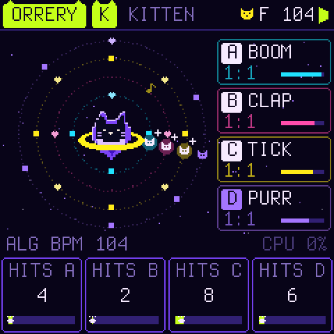
  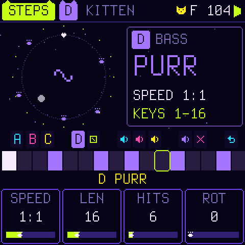
  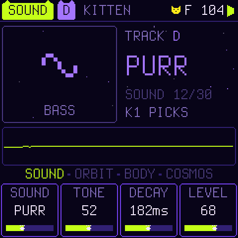
</p>

Four planets circle a sun. How fast each one goes against the others is a small ratio, 1:1, 5:4, 3:2, 7:4, and the
same ratio heard as pitch is a pure interval above the sun. So a polyrhythm of 4 against 5 against 6 against 7 *is*
the chord 4:5:6:7. The rhythms are strange: quintuplets against septuplets, and cycles that meet only every few bars.
But every note sits on the sun's harmonic series, so the whole thing fuses into one chord without a beat.

The voice is a planet on an ellipse, and what you hear is where it is.

> **Status:** in development. Everything here runs on the host (the same C, the sound as WAV, the screen as images)
> and in the browser on [the page](https://joakimskurk.github.io/fm1orbitrix/) (the same C, compiled to WebAssembly).
> It builds for the FM-1 and the SMK-37 and passes Dinghy's checks and tests. It has **not yet been tested on a real
> FM-1**, and there is no release yet.

## A groove in a minute

1. Switch on. The legend plays; **PLAY** skips it. **KITTEN** is waiting: a kick, a clap, hats, a purring bass, on the
   grid. Press **PLAY**.
2. Press **SEQ**: **STEPS**. The white keys are the steps of a track: tap one, rest → hit → accent → rest. The black
   keys do the rest, and the screen draws each one over its key:

   | Black keys | |
   | --- | --- |
   | **F# G# A# C#** (lower) | pick track A, B, C, D |
   | **D#** (lower) | **IDEA**: a new pattern for the track, as its sound wants one (a kick on the beat, a snare's backbeat, hats between, a bass on the root, a melody on the chord's tones) |
   | **F# G# A# C#** (upper) | mute A, B, C, D (lit while it plays; muted, it naps) |
   | **D#** (upper) · **F#** (top) | **CLEAR** the track · **UNDO** (and again: redo) |

3. Press **EDIT**: **SOUND**. K1 picks the track's sound by name from 30 (BOOM, THUMP, TOM, PAT, CLAP, TICK, TSSS,
   ZAP, BOOP, SQUEAK, BLOOP, PURR, GROWL, SUB, SWOOP, PLUCK, PAW, GLASS, BELL, STAR, TIDAL, TOY, PIXEL, LEAD, FLUTE,
   MEOW, MEW, CLOUD, DRONE, COMET);
   stopped, you hear it at once. K2–K4: TONE, DECAY, LEVEL; with SEL: OCT, PAN, SPACE, WOBBLE.
4. The keys play the **focus**, the chip at the top: a track's sound (where its ring plays it) or, as K, the keys' own.
   **REC** writes what you play into the track, the note you hear. **SELECT** turns the focus.
5. **HOME**: K1–K4 set each track's hits; with SEL, their levels. **SAVE**, **SAVE** keeps it in U1.

Each button's pages show on the hint line as you press it, this one lit: **EDIT** is SOUND → ORBIT → BODY → COSMOS,
from the friendly to the deep. For a lullaby, turn **PRESETS** once: **MILKY WAY**.

## Astralica, at home

She is the sun the orbits go round. She bobs on every beat, blinks, and a note rises from her each bar; her eyes light
where the orbits meet, and close happily (^ ^) at an IDEA, a SAVE, a new system or PLAY. Play the keys and she sings
along in a bubble (mew, nya, mrrp, prr). Stop, and she naps: zz. The planets are her kittens, in their tracks' colours;
an accent is a heart, a hit on STEPS a paw, and hearts rise when you set one. Every title and focus wears ears, every
gauge ends in a paw; TIME's playhead and the LFOs carry a kitten, the ORBIT PAD's point is one, COSMOS is five of them
round her, CHAOS is a ball of yarn, TIDE a fish, HORIZON a black hole with ears, and on KEYS the keys you play show a paw.

## The legend of Astralica

In the beginning the universe was silent. Then came **Astralica**, a black cat in a violet coat with a yellow ring
round her. She grew, and grew: one big ass cat. She ate the planets and made their orbits sing, and now her song
rings through the multiverses.

ORBITRIX tells it at power-on, in about fourteen seconds, scored by its own engine: a drone, a chirp as each planet
falls in, the universe sliding into her horizon, the orrery's rings, and her meow, echoing from universe to universe.
**Press PLAY to skip it** (the splash too, straight to the instrument); KEYS → SEL → INTRO turns it off.

<p align="center">
  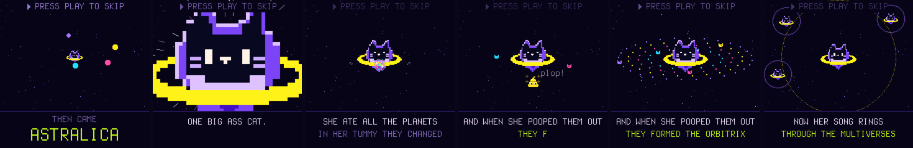
</p>

## The sound: orbit synthesis

| | |
| --- | --- |
| **ECC** | The orbit's eccentricity, solved from Kepler's equation `M = E − e sin E` by table. At 0 it is a pure sine. Turned up, the planet slows far out and whips through the near point, and the sound brightens. Its spectrum is a series of Bessel functions, as in FM: Bessel found them solving this very equation. |
| **SLING** | Hear the planet's speed instead of its place: the slingshot past the sun, a bright pulse. |
| **ANG**, **SPR** | Which view of the orbit you hear: x and y have different spectra. The left channel looks from one angle and the right from another, so the stereo comes from the geometry. L + R is again a view, so it never cancels in mono. |
| **PREC** | Precession: the ellipse turns slowly, and the timbre and the stereo image turn with it. |
| **MOON**, its **RATIO** | A moon circling the planet, an epicycle. On whole ratios it adds harmonics; on φ, √2, e, π or a bell's 2.76 it adds metal and glass. |
| **DUST**, **COLOR** | Noise in the orbit, dark to bright: breath, hiss, a snare's wires, comets. |
| **PIXEL** | The orbit on a coarse grid: an 8-bit planet. |
| **FALL** | The pitch falls onto the note: a kick's infall, a tom, a swoop. |

Each sound also has an amplitude envelope, an eccentricity envelope (the orbit stretching and relaxing, as FM's index
envelope), velocity, pan and a send to SPACE. A per-note cap, measured from the spectra, keeps the aliases above
20 kHz (60 dB down), and the tests check it.

## The strange part: tide, inspiral, beam, horizon

Most of the time ORBITRIX is in tune with itself. These four push it somewhere stranger, and most systems use them
only at moments: where the orbits meet, at the end of a long ramp, when the pad's point dips.

| | |
| --- | --- |
| **TIDE** | The planets pull on each other: the voices' sum, a block late, modulates each one's phase (FM between the voices). The rings stand on ratios of one sun, so the sidebands land on that sun's harmonic series: alien, metallic, and still consonant. Turned far up it becomes the three-body problem. Each sound sets how hard it is pulled; the TIDE macro and the TIDE destination set how strong the pull is (CONJ → TIDE: they tug where they meet). |
| **INSPIRAL** | A binary's chirp: the note starts up to four octaves under and rises along a merger's law (frequency as (t_c − t)^−3/8, slow, then all at once), growing as it rises, and lands exactly on the note. At the merge the eccentricity envelope flashes: the ring-down. |
| **BEAM** | A pulsar: the planet's light sweeps past in narrow pulses at the moon's ratio (amplitude modulation at audio rate). |
| **HORIZON** | The sound falls into a black hole. A memory of the mix and two grains about a source point that slows to a standstill. It is redshifted (SHIFT, down to two octaves at full depth; blueshift too), stretched, frozen when deep, and RETRO plays a share of the grains backwards. It is a macro and a destination: LFO 1's ramp, or the pad's point dipping, take the music in now and then. |

<p align="center">
  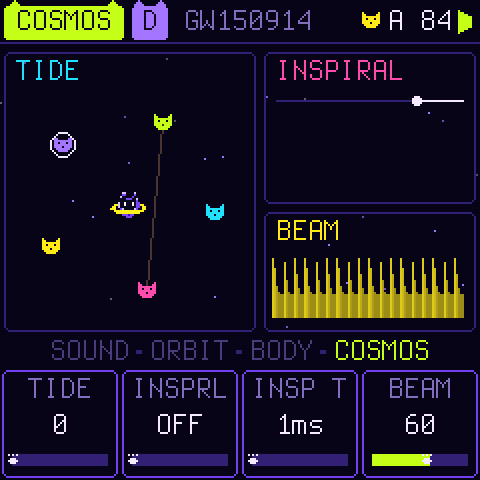
  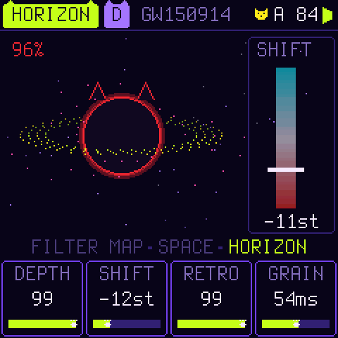
  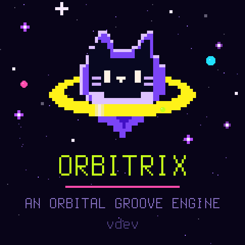
</p>

## Harmony: gravity

Everything is tuned to the **sun**, a pitch class you move with SEL + a key.

- **Tunings:** JUST (5- and 7-limit), OTONAL (the overtone scale: 1/1 9/8 5/4 11/8 3/2 13/8 7/4 15/8), UTONAL (its
  dark mirror), PENTA, and ET.
- **SOLAR keys:** the ordinary keyboard, each key retuned to its interval's ratio above the sun. Chords ring without
  beating. The KEYS page shows each key's cents.
- **HARMONIC keys:** the 16 white keys are harmonics 1–16 of the sun, the black keys 17–27. Play the overtone series
  itself.
- **GRAVITY:** at 0, equal temperament as played; at 50, fully just. Above 50 a note *falls* into tune: it starts
  where the last one was and spirals in on a damped spring, overshooting and settling, like a voice finding the pitch.

<p align="center">
  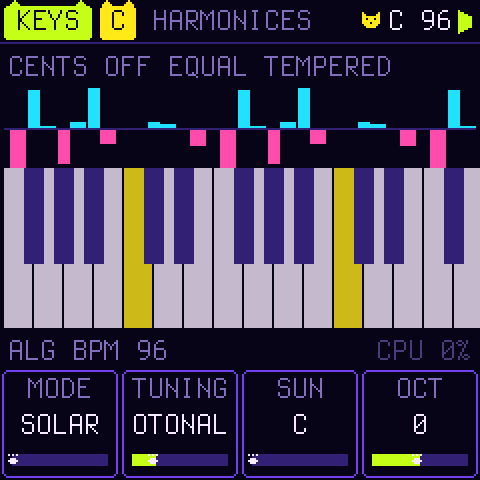
  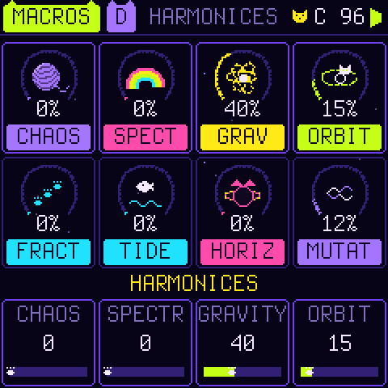
  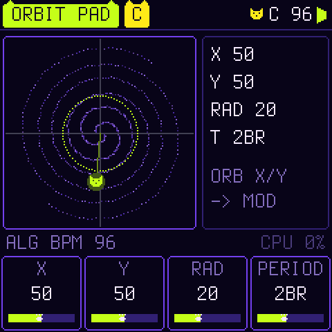
</p>

## Rhythm: the Orrery

There are four rings, A–D, each with its own sound and one voice, so a conjunction is a chord across the rings. Four
more voices are for the keys.

| | |
| --- | --- |
| **SPEED** | The ring's speed against a 16th: 1:4 … 1:1 … 5:4, 3:2, 7:4 … 4:1. The clock counts 2520 ticks a 16th (lcm 1..10), so every ratio meets the others exactly, forever. |
| **LEN**, **HITS**, **ROT** | Up to 64 steps, hits spread evenly and turned. Set steps by hand on the white keys (STEPS). |
| **NOTE** | The degree the ring sings; each step adds its own (hold a step, turn K1). The screen names it as a ratio. |
| **DIR** | FWD, REV, PING, SPIRAL (the pattern turns one step each lap: rhythmic precession), RND. |
| **LOGIC** | FREE, AND x, NOT x, XOR x against another ring's current step, or CONJ: only together with another ring. NOT makes interlocking parts. |
| **Conjunctions** | When rings fire on the same tick, those hits are accented and the CONJ modulation source flares. The long cycle's downbeats show up by themselves. |

SWING, **MUTATE** (each lap plays a variation of the pattern: some hits move a step, some degrees go to a neighbour;
drawn afresh each lap from the pattern as you wrote it, which never changes: the orrery shows the varied steps hollow),
**HUM** (humanised timing and velocity) and **VAR** apply to all four rings.

<p align="center">
  
  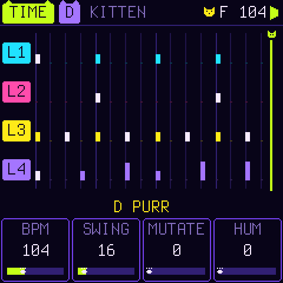
  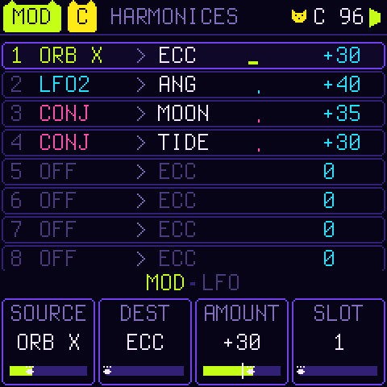
</p>

## Movement and FX

- **Macros:** CHAOS (the orbits wobble and the moons drift off whole ratios), SPECTRAL (brighter), GRAVITY, ORBIT
  (wider, turning faster), and on the second row FRACT (pixels, and hits splitting into 2–4 ratchets), TIDE, HORIZON
  and MUTATE. At 0 each one leaves the system as programmed.
- **ORBIT PAD:** a point circling (X, Y) at a radius, once in its period (1/8 to 16 bars, on the orrery's clock). Its
  X and Y are modulation sources.
- **Modulation:** two LFOs (sine, triangle, saw, square, S&H, drift; free or on the clock) and an 8-slot matrix from
  LFO1 LFO2 ORB-X ORB-Y RND STEP CONJ VEL MODW AFT onto ECC SLING ANG SPR MOON DUST PIXEL PITCH CUT RES MODE SEND FDBK
  RAD PREC LEVEL PROB TIDE HORIZON BEAM.
- **FILTER MAP:** a stereo state-variable filter on the master, its mode morphing LP → BP → HP, with drive. While it
  is open it costs nothing.
- **SPACE:** a stereo delay in beat fractions (ping-pong, tone) into **NEBULA**, a four-line feedback delay network
  with size, decay and damping. Each sound has its own send.

<p align="center">
  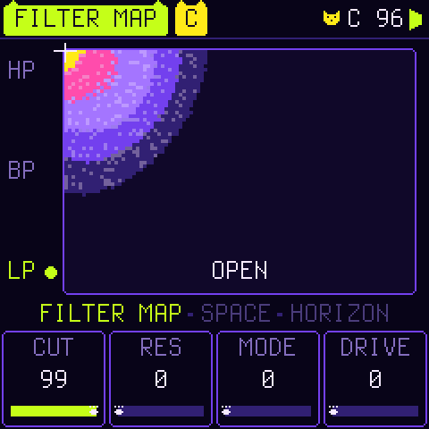
  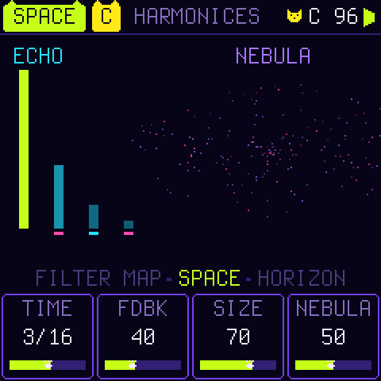
  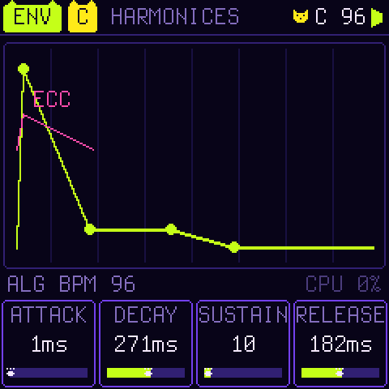
</p>

## Fifteen systems

The first two are to start from, a beat and a lullaby; the others are named after real resonances in the sky.

| | Rings | |
| --- | --- | --- |
| **KITTEN** | 1:1 1:1 1:1 1:1 | a kick on the beat, a clap's backbeat, hats in 8ths, a purring bass on the root, its fifth and 7/4; the keys a soft paw. Nothing mutates: yours to change |
| **MILKY WAY** | 1:1 1:1 3:2 1:2 | a lullaby: a music box twinkling at 3:2 over pitched boops, a soft kick on 1 and 3, a purring bass at half speed, pentatonic, a little swing; the keys mew |
| **HARMONICES** | 1:1 5:4 3:2 7:4, 4 5 6 7 hits a bar | 4:5:6:7 as a rhythm and as a chord, in the overtone scale |
| **GALILEAN** | 1:1 1:2 1:4 2:1 | Io, Europa and Ganymede's 1:2:4: four on the floor, a bass, a pad, hats that keep out of the kick's way |
| **TRAPPIST** | 1:1 3:2 5:3 8:5 | a resonant chain of glassy plucks that mutate |
| **KIRKWOOD** | 1:3 1:1 5:6 2:3 | the asteroid gaps against Jupiter (3, 5/2, 2): pixel percussion |
| **SPIRAL DRIFT** | 1:1 3:2 5:4 7:5, 16 24 20 28 steps | everything SPIRAL, PROB 74, MUTATE 42 |
| **PULSAR** | 1:1 1:1 2:1 1:2 | drums: an infall kick, a dust snare, pixel hats, a bass |
| **NEBULA** | 1:3 1:2 2:3 3:4 | slow, UTONAL, moons, a deep NEBULA, notes falling into tune |
| **ROCHE** | 5:4 4:3 7:5 3:2 | torn apart: bells off whole ratios, dust, CHAOS |
| **LAGRANGE** | 1:1 1:2 3:2 2:1 | HARMONIC keys over a calm orbit |
| **ACCRETION** | 1:2 1:1 3:4 3:2 | GRAVITY high: every note falls into tune, the rings glide |
| **GW150914** | 1:2 1:1 3:2 2:1 | the first merger heard: notes chirp up from octaves below and ring down; every second bar it slides a little into the horizon |
| **ALPHA CEN** | 1:1 4:3 5:3 1:4 | a triple star: the rings pull hard on each other (TIDE), the three-body problem, tuned |
| **SGR A*** | 1:2 2:3 1:3 3:4 | the black hole at the centre: deep, UTONAL; when the pad's point dips, everything slides in, redshifted and partly backwards |

There are also eight places of your own, U1–U8.

## The controls

Every page is laid out the same way. The top line holds the page, the focus (K for the keys, or A–D), the system,
the sun with Astralica's head, and the tempo. Then come the picture, the hint line (a message, a button's pages, or
ALGORITHM's value and the load) and K1–K4 as four boxes.

| Control | What it does |
| --- | --- |
| **HOME** | ORRERY (K1–K4: the hits of A–D; SEL: their levels) → MACROS (CHAOS SPECTRAL GRAVITY ORBIT · FRACT TIDE HORIZON MUTATE) |
| **SEQ** | STEPS (SPEED LEN HITS ROT · NOTE DIR PROB LOGIC; the keys as above) → TIME (tempo, swing, mutate, the lanes) |
| **EDIT** | SOUND (SOUND TONE DECAY LEVEL · OCT PAN SPACE WOBBLE) → ORBIT (ECC SLING ANG SPR · PREC MOON RATIO DUST) → BODY (FALL COLOR PIXEL · LEVEL PAN SEND OCT) → COSMOS (TIDE INSPIRAL INSP-T BEAM) |
| **ENV** · **LFO** | the envelopes · MOD → LFO |
| **FX** · **GLO** · **ARP** | FILTER MAP → SPACE → HORIZON (DEPTH SHIFT RETRO GRAIN) · ORBIT PAD · KEYS (mode, tuning, sun, octave, gravity, MIDI channel, INTRO) |
| **K1–K4**, **SEL** held | the four values; the second row (the names turn magenta) |
| **ALGORITHM** | the page's extra, on the hint line (mostly the tempo) |
| **SELECT** | the focus: K (the keys), A, B, C, D: what the pages edit and the keys play |
| **PRESETS** | the system, loaded once it rests; in SAVE, the place |
| **PLAY** · **REC** | the orrery · the keys write into the focused track |
| **SAVE**, SAVE | store the system in U1–U8 |
| **SEL + a key** | the sun moves there |
| **SEL + SEQ** | the focused track muted or not |
| **OCT− OCT+** | the keys' octave; on STEPS, which 16 steps the white keys show |
| **STEPS' keys** | white: the steps (a tap goes rest → hit → accent; hold one and turn K1 for its note); black: tracks, IDEA, mutes, CLEAR, UNDO |

**MIDI:** notes play the focus (USB and the TRS jack, OMNI or a channel), and REC writes them; CC 1 is MODW,
channel pressure AFT. A clock sets the tempo, and START and STOP run the orrery.

## Build it

The same as Dinghy ([docs/DINGHY.md](docs/DINGHY.md)): the JieLi toolchain (`tools/get_toolchain.sh`), three files of
the AC79 SDK, Python 3 with Pillow (and numpy for the tables).

```sh
python3 tools/gen_tables.py      # the laws as tables -> firmware/src/orb_tables.h (only when you change them)
tests/run_orb.sh                 # the engine: tests (twice, the second under ASan/UBSan), renders, pictures, bench
tests/run_host.sh tests/scripts/pages.txt   # the app on the host: every page as an image, the sound as WAV
./build.sh                       # -> build/orbitrix.fwsc (FM-1_96700); BOARD=smk37 for the SMK-37
python3 tools/fm1_install.py build/orbitrix.fwsc   # onto an FM-1 over USB (it asks first)
```

`build/audio/tour/` holds the fifteen systems with a progression on the keys, `build/audio/lib/` every sound SOUND
can pick, `build/look/` their spectrograms. `tools/readme_screens.sh` makes the screens here.

Hold **OCT−** while switching on for the USB rescue. Any firmware in the
[FM-1 Firmware Hub](https://thefirmwarehub.com) can be installed over ORBITRIX, and back. Installing firmware is at
your own risk.

## On the page

[joakimskurk.github.io/fm1orbitrix](https://joakimskurk.github.io/fm1orbitrix/) runs the firmware itself in the
browser: `firmware/src/orbitrix.c`, unchanged, compiled to WebAssembly on a web FM-1 (`web/app/web_host.c`), its
sound made in the audio thread (`web/app/worklet.js`), the panel drawn by `web/app/play.js`: the screen, the knobs,
the buttons (SEL latches), the 27 keys, the computer's keyboard and a MIDI keyboard. Its settings and U1–U8 stay in
the browser. The page also has the legend's film, the fifteen systems to hear, and the installer (Web MIDI, Chrome or
Edge). CI builds and publishes it from `main` (`web/make_site.py`).

```sh
sh web/app/build.sh                                  # -> build/web/orbitrix.wasm (clang and lld)
python3 web/make_site.py build/orbitrix.fwsc dev build/site    # after tests/run_orb.sh and tools/make_film.sh
```

Departures from Dinghy's own files: `platform.c` includes `web/app/web_host.c` instead of `tests/host.c` when
`DINGHY_WEB` is set; `orbitrix.c` runs its start, the story, the splash and its main loop as passes, so the page can
run one a millisecond.

## Where things are

```
docs/orbitrix/PLAN.md       the design: the idea, the sound, harmony, rhythm, the screens, the budget
firmware/src/orb_engine.h   the engine (orbit voices, gravity, the orrery, modulation, the filter map, SPACE)
firmware/src/orb_systems.h  the sound library (30 sounds by name) and the fifteen systems
firmware/src/orbitrix.c     the app: pages, the panel, storage, MIDI
tools/gen_tables.py         Kepler's equation, the aliasing caps, pitch, envelopes, the tunings, the chirp: the tables
tools/gen_splash.py         the splash's cat-planet as pixel art (assets/cat_source.png, if there, is sampled instead)
tools/make_film.sh          a film of the firmware on the host (the legend by default) -> build/film/astralica.mp4
web/                        the page: index.html, make_site.py, app/ (the web FM-1, the audio thread, the panel)
tools/orb_render.c          the engine to WAV; tools/orb_look.py the spectrograms
tests/orb_test.c            the engine's tests
```

## Licence

GPL-3.0-only, as Dinghy, Felucca and SLOOP. Details, credits and third-party parts are in [LICENSING.md](LICENSING.md).
The platform is Dinghy 0.5 (zvenson), on Felucca (Leo Kuroshita, Hügelton Instruments) and SLOOP (isod89), with the
SMK-37 layer by M. Geisler (genkigenki). ORBITRIX itself (the engine, the app, the systems, the docs, the cat) is by
joakimskurk.
