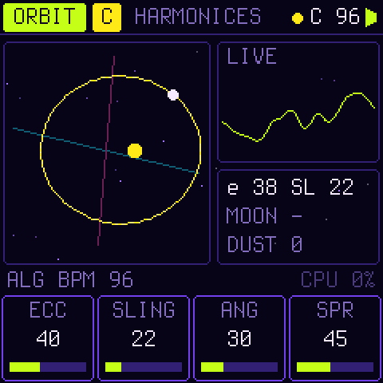
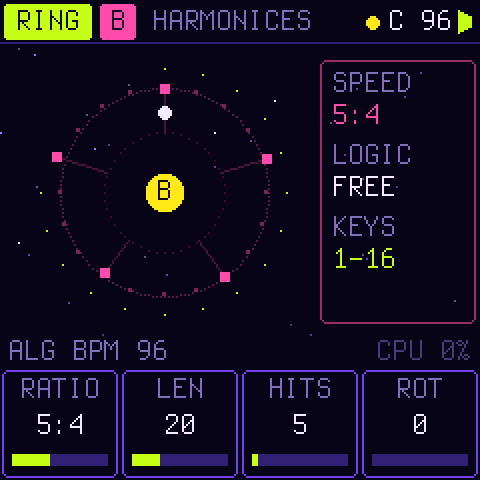

<p align="center">
  
</p>

<h1 align="center">ORBITRIX</h1>

<p align="center">
  <b>An orbital groove engine for the M-VAVE FM-1.</b><br>
  Every rhythm is an interval, and every interval a rhythm.
</p>

<p align="center">
  
  
  
  
</p>

<p align="center">
  
  
  
</p>

Four planets circle a sun. How fast each one goes against the others is a small ratio, 1:1, 5:4, 3:2, 7:4, and the
same ratio heard as pitch is a pure interval above the sun. So a polyrhythm of 4 against 5 against 6 against 7 *is*
the chord 4:5:6:7. The rhythms are strange: quintuplets against septuplets, and cycles that meet only every few bars.
But every note sits on the sun's harmonic series, so the whole thing fuses into one chord without a beat.

The voice is a planet on an ellipse, and what you hear is where it is.

> **Status:** in development. Everything here runs on the host: the same C, the sound as WAV, the screen as images.
> It builds for the FM-1 and the SMK-37 and passes Dinghy's checks and tests. It has **not yet been tested on a real
> FM-1**, and there is no release yet.

## The sound: orbit synthesis

| | |
| --- | --- |
| **ECC** | The orbit's eccentricity, solved from Kepler's equation `M = E − e sin E` by table. At 0 it is a pure sine. Turned up, the planet slows far out and whips through the near point, and the sound brightens. Its spectrum is a series of Bessel functions, as in FM: Bessel found them solving this very equation. |
| **SLING** | Hear the planet's speed instead of its place: the slingshot past the sun, a bright pulse. |
| **ANG**, **SPR** | Which view of the orbit you hear: x and y have different spectra. The left channel looks from one angle and the right from another, so the stereo comes from the geometry. L + R is again a view, so it never cancels in mono. |
| **PREC** | Precession: the ellipse turns slowly, and the timbre and the stereo image turn with it. |
| **MOON**, its **RATIO** | A moon circling the planet, an epicycle. On whole ratios it adds harmonics; on φ, √2, e, π or a bell's 2.76 it adds metal and glass. |
| **DUST**, **COLOR** | Noise in the orbit, dark to bright: breath, hiss, a snare's wires, comets. |
| **PIXEL** | The orbit on a coarse grid: an 8-bit planet. |
| **FALL** | The pitch falls onto the note: a kick's infall, a tom, a swoop. |

Each sound also has an amplitude envelope, an eccentricity envelope (the orbit stretching and relaxing, as FM's index
envelope), velocity, pan and a send to SPACE. A per-note cap, measured from the spectra, keeps the aliases above
20 kHz (60 dB down), and the tests check it.

## Harmony: gravity

Everything is tuned to the **sun**, a pitch class you move with SEL + a key.

- **Tunings:** JUST (5- and 7-limit), OTONAL (the overtone scale: 1/1 9/8 5/4 11/8 3/2 13/8 7/4 15/8), UTONAL (its
  dark mirror), PENTA, and ET.
- **SOLAR keys:** the ordinary keyboard, each key retuned to its interval's ratio above the sun. Chords ring without
  beating. The KEYS page shows each key's cents.
- **HARMONIC keys:** the 16 white keys are harmonics 1–16 of the sun, the black keys 17–27. Play the overtone series
  itself.
- **GRAVITY:** at 0, equal temperament as played; at 50, fully just. Above 50 a note *falls* into tune: it starts
  where the last one was and spirals in on a damped spring, overshooting and settling, like a voice finding the pitch.

<p align="center">
  
  
  
</p>

## Rhythm: the Orrery

There are four rings, A–D, each with its own sound and one voice, so a conjunction is a chord across the rings. Four
more voices are for the keys.

| | |
| --- | --- |
| **RATIO** | The ring's speed against a 16th: 1:4 … 1:1 … 5:4, 3:2, 7:4 … 4:1. The clock counts 2520 ticks a 16th (lcm 1..10), so every ratio meets the others exactly, forever. |
| **LEN**, **HITS**, **ROT** | Up to 64 steps, hits spread evenly and turned. Set steps by hand on the white keys (RING). |
| **DEG** | The degree the ring sings; each step adds its own (hold a step, turn K1). The screen names it as a ratio. |
| **DIR** | FWD, REV, PING, SPIRAL (the pattern turns one step each lap: rhythmic precession), RND. |
| **LOGIC** | FREE, AND x, NOT x, XOR x against another ring's current step, or CONJ: only together with another ring. NOT makes interlocking parts. |
| **Conjunctions** | When rings fire on the same tick, those hits are accented and the CONJ modulation source flares. The long cycle's downbeats show up by themselves. |

SWING, **MUTATE** (at each lap, hits move and degrees step to a neighbour), **HUM** (humanised timing and velocity)
and **VAR** apply to all four rings.

<p align="center">
  
  
  
</p>

## Movement and FX

- **Macros:** CHAOS (the orbits wobble and the moons drift off whole ratios), SPECTRAL (brighter), GRAVITY, FRACT
  (pixels, and hits splitting into 2–4 ratchets), ORBIT (wider, turning faster). At 0 each one leaves the system as
  programmed.
- **ORBIT PAD:** a point circling (X, Y) at a radius, once in its period (1/8 to 16 bars, on the orrery's clock). Its
  X and Y are modulation sources.
- **Modulation:** two LFOs (sine, triangle, saw, square, S&H, drift; free or on the clock) and an 8-slot matrix from
  LFO1 LFO2 ORB-X ORB-Y RND STEP CONJ VEL MODW AFT onto ECC SLING ANG SPR MOON DUST PIXEL PITCH CUT RES MODE SEND FDBK
  RAD PREC LEVEL PROB.
- **FILTER MAP:** a stereo state-variable filter on the master, its mode morphing LP → BP → HP, with drive. While it
  is open it costs nothing.
- **SPACE:** a stereo delay in beat fractions (ping-pong, tone) into **NEBULA**, a four-line feedback delay network
  with size, decay and damping. Each sound has its own send.

<p align="center">
  
  
  
</p>

## Ten systems

Named after real resonances in the sky.

| | Rings | |
| --- | --- | --- |
| **HARMONICES** | 1:1 5:4 3:2 7:4, 4 5 6 7 hits a bar | 4:5:6:7 as a rhythm and as a chord, in the overtone scale |
| **GALILEAN** | 1:1 1:2 1:4 2:1 | Io, Europa and Ganymede's 1:2:4: four on the floor, a bass, a pad, hats that keep out of the kick's way |
| **TRAPPIST** | 1:1 3:2 5:3 8:5 | a resonant chain of glassy plucks that mutate |
| **KIRKWOOD** | 1:3 1:1 5:6 2:3 | the asteroid gaps against Jupiter (3, 5/2, 2): pixel percussion |
| **SPIRAL DRIFT** | 1:1 3:2 5:4 7:5, 16 24 20 28 steps | everything SPIRAL, PROB 74, MUTATE 42 |
| **PULSAR** | 1:1 1:1 2:1 1:2 | drums: an infall kick, a dust snare, pixel hats, a bass |
| **NEBULA** | 1:3 1:2 2:3 3:4 | slow, UTONAL, moons, a deep NEBULA, notes falling into tune |
| **ROCHE** | 5:4 4:3 7:5 3:2 | torn apart: bells off whole ratios, dust, CHAOS |
| **LAGRANGE** | 1:1 1:2 3:2 2:1 | HARMONIC keys over a calm orbit |
| **ACCRETION** | 1:2 1:1 3:4 3:2 | GRAVITY high: every note falls into tune, the rings glide |

There are also eight places of your own, U1–U8.

## The controls

Every page is laid out the same way. The top line holds the page, the focus (KEYS, A–D), the system, the sun and the
tempo. Then come the picture, the hint line (ALGORITHM's value, the load) and K1–K4 as four boxes.

| Control | What it does |
| --- | --- |
| **HOME** | ORRERY (K1–K4: the hits of A–D; SEL: their rotation) → MACROS |
| **SEQ** | RING (the focused ring) → TIME (tempo, swing, mutate, the lanes) |
| **EDIT** | ORBIT (ECC SLING ANG SPR · PREC MOON RATIO DUST) → BODY (FALL COLOR PIXEL · LEVEL PAN SEND OCT) |
| **ENV** · **LFO** | the envelopes · MOD → LFO |
| **FX** · **GLO** · **ARP** | FILTER MAP → SPACE · ORBIT PAD · KEYS (mode, tuning, sun, octave, gravity, MIDI channel) |
| **K1–K4**, **SEL** held | the four values; the second row (the names turn magenta) |
| **ALGORITHM** | the page's extra, on the hint line (mostly the tempo) |
| **SELECT** | the focus: KEYS, A, B, C, D |
| **PRESETS** | the system, loaded once it rests; in SAVE, the place |
| **PLAY** · **REC** | the orrery · the keys write into the focused ring |
| **SAVE**, SAVE | store the system in U1–U8 |
| **SEL + a key** | the sun moves there |
| **SEL + SEQ** | the focused ring muted or not |
| **OCT− OCT+** | the keys' octave; on RING, which 16 steps the white keys show |
| **RING's white keys** | the steps: a tap goes rest → hit → accent; hold one and turn K1 for its degree |

**MIDI:** notes play the keys (USB and the TRS jack, OMNI or a channel); CC 1 is MODW, channel pressure AFT. A clock
sets the tempo, and START and STOP run the orrery.

## Build it

The same as Dinghy ([docs/DINGHY.md](docs/DINGHY.md)): the JieLi toolchain (`tools/get_toolchain.sh`), three files of
the AC79 SDK, Python 3 with Pillow (and numpy for the tables).

```sh
python3 tools/gen_tables.py      # the laws as tables -> firmware/src/orb_tables.h (only when you change them)
tests/run_orb.sh                 # the engine: tests (twice, the second under ASan/UBSan), renders, pictures, bench
tests/run_host.sh tests/scripts/pages.txt   # the app on the host: every page as an image, the sound as WAV
./build.sh                       # -> build/orbitrix.fwsc (FM-1_96700); BOARD=smk37 for the SMK-37
python3 tools/fm1_install.py build/orbitrix.fwsc   # onto an FM-1 over USB (it asks first)
```

`build/audio/tour/` holds the ten systems with a progression on the keys, `build/look/` their spectrograms.

Hold **OCT−** while switching on for the USB rescue. Any firmware in the
[FM-1 Firmware Hub](https://thefirmwarehub.com) can be installed over ORBITRIX, and back. Installing firmware is at
your own risk.

## Where things are

```
docs/orbitrix/PLAN.md       the design: the idea, the sound, harmony, rhythm, the screens, the budget
firmware/src/orb_engine.h   the engine (orbit voices, gravity, the orrery, modulation, the filter map, SPACE)
firmware/src/orb_systems.h  the ten systems
firmware/src/orbitrix.c     the app: pages, the panel, storage, MIDI
tools/gen_tables.py         Kepler's equation, the aliasing caps, pitch, envelopes, the tunings: the tables
tools/orb_render.c          the engine to WAV; tools/orb_look.py the spectrograms
tests/orb_test.c            the engine's tests
```

## Licence

GPL-3.0-only, as Dinghy, Felucca and SLOOP. Details, credits and third-party parts are in [LICENSING.md](LICENSING.md).
The platform is Dinghy 0.5 (zvenson), on Felucca (Leo Kuroshita, Hügelton Instruments) and SLOOP (isod89), with the
SMK-37 layer by M. Geisler (genkigenki). ORBITRIX itself (the engine, the app, the systems, the docs) is by joakimskurk.
